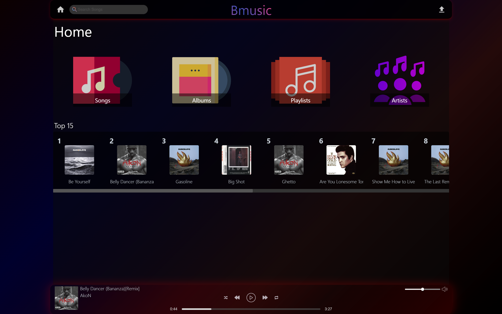

# bmusic

Self-hosted music streaming for your local network. Upload your own audio files, browse them by song, album and artist, build playlists and play them in the browser.



Demo video: https://youtu.be/EFCkw3S3fM4

## Stack

| Part     | Technology                       | Folder                   |
| -------- | -------------------------------- | ------------------------ |
| UI       | Angular 18                       | [bmusic-ui](bmusic-ui)   |
| API      | Node.js 22, Express              | [bmusic-api](bmusic-api) |
| Database | PostgreSQL 17                    | [database](database)     |
| Storage  | Local disk (`bmusic-api/data/`)  |                          |

See [docs/ARCHITECTURE.md](docs/ARCHITECTURE.md) for the code structure and the API reference.

## Configuration

All configuration lives in one `.env` file in the repository root. Create it from the example and set a database password:

```bash
cp .env.example .env
```

| Variable            | Default     | Description                                                      |
| ------------------- | ----------- | ---------------------------------------------------------------- |
| `POSTGRES_USER`     |             | Database user (created on first start)                           |
| `POSTGRES_PASSWORD` |             | Database password                                                |
| `POSTGRES_DB`       |             | Database name                                                    |
| `POSTGRES_HOST`     | `localhost` | Database host for local runs. Docker Compose sets it to `database` |
| `POSTGRES_PORT`     | `5432`      | Database port                                                    |
| `PORT`              | `4000`      | API port                                                         |
| `CORS_ORIGIN`       | `*`         | Allowed origin for API requests                                  |
| `DATA_DIR`          | `bmusic-api/data` | Where uploaded audio and covers are stored                 |

The UI calls the API on port 4000 of whatever host it was loaded from, so opening `http://<server-ip>:4200` from a phone on the same network works without extra configuration.

## Run with Docker (recommended)

Requires Docker with Compose v2.

### Development

Source folders are mounted into the containers and both the API and UI reload on changes.

```bash
docker compose up --build
```

- UI: http://localhost:4200
- API: http://localhost:4000
- PostgreSQL: localhost:5432

### Production

Builds optimized images. The UI is served by nginx and the database is not exposed.

```bash
docker compose -f docker-compose.prod.yml up --build -d
```

- UI: http://localhost:4200
- API: http://localhost:4000

Stop with `docker compose -f docker-compose.prod.yml down`. Data is kept in the named volumes `database_data`, `uploads_data` and `covers_data`; add `-v` to the `down` command to delete it.

## Run without Docker

Requires Node.js 22+ and a running PostgreSQL server.

1. Create the database and load the schema (uses the values from your `.env`):

   ```bash
   psql -U postgres -c "CREATE USER bmusic WITH PASSWORD 'change-me';"
   psql -U postgres -c "CREATE DATABASE bmusic OWNER bmusic;"
   psql -U bmusic -d bmusic -f database/V1___initial_schema.sql
   ```

2. Start the API (reads the root `.env`):

   ```bash
   cd bmusic-api
   npm install
   npm run dev
   ```

3. Start the UI in a second terminal:

   ```bash
   cd bmusic-ui
   npm install
   npm start
   ```

Open http://localhost:4200.

## Usage

- **Upload**: click the upload icon in the header and pick files or a whole folder. Supported audio: mp3, flac, wav, ogg, aac, m4a. Include one image (jpg, png, webp) to use it as the album cover, so upload one album at a time. Title, artist, album, genre and length are read from the file tags.
- **Play**: click a song. Next, previous and shuffle move through the list the song was started from (an album, an artist, a playlist or all songs).
- **Playlists**: create playlists on the Playlists page and add songs from the menu on each song row. Favorites is built in and cannot be deleted.

## Scripts

| Location     | Command         | Description                         |
| ------------ | --------------- | ----------------------------------- |
| `bmusic-api` | `npm run dev`   | Start the API with auto-reload      |
| `bmusic-api` | `npm start`     | Start the API                       |
| `bmusic-ui`  | `npm start`     | Start the UI dev server on port 4200 |
| `bmusic-ui`  | `npm run build` | Production build into `dist/`       |

## License

See [LICENSE.MD](LICENSE.MD).
